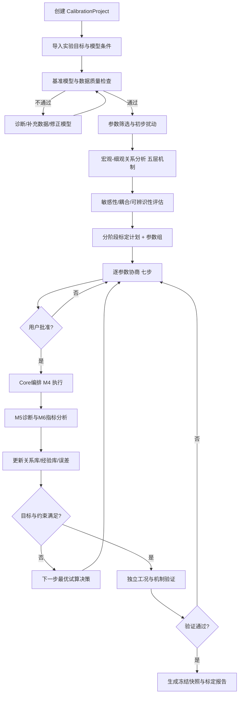

## PFC Interaction 5.0.1 — 参数识别与标定核心子系统技术规范

> 文档类型：专项技术规范
> 版本：V2.0（V1.0 基础上整合三轮设计讨论共识：架构 A 方案、两类核心机制深化、B 方案强制原则、规则库与经验库、下一步最优试算）
> 适用系统：PFC Interaction 5.0.1
> 子系统标识：S4 — Parameter Identification & Calibration System（参数识别与标定核心子系统）
> 状态：设计规范，待实现与验收
> 核心原则：证据驱动、独立论证与联合识别并行、逐参数协商、分阶段标定、可追溯、可复现、用户确认
> 文档定位声明：本规范为设计建议与验收要求，所述机制不代表现有 Skill 已实现。凡“必须/强制/禁止”条款均为设计与验收口径，实现状态以实施优先级（第 13 章）与验收记录为准。

---

## 0. 规范目的、结论与三条最高原则

本规范定义 PFC Interaction 5.0.1 中宏观—细观参数识别与标定核心子系统（S4）的定位、职责、工作流程、数据结构、交互协议、规则库、决策引擎、执行边界和验收标准。

S4 不是一个"输入目标值、自动搜索参数、输出最优解"的孤立优化器，而是一个围绕科研标定决策构建的独立核心子系统。它必须回答：

1. 当前宏观响应与实验目标之间存在什么偏差？
2. 哪些细观参数可能解释这些偏差？证据来自哪里、可信等级如何？
3. 各参数对多个宏观指标的影响方向、强度、非线性和交互关系是什么？
4. 哪些参数在当前数据和实验设计下可辨识，哪些存在等效解或强耦合？
5. 当前最值得进行哪一个参数扰动、哪一组试验，或哪一个新增观测？
6. 调整某个参数可能改善哪些指标、损害哪些指标？
7. 下一轮应单参数试探、局部联合调整，还是增加新的观测/试验？
8. 标定结果是否通过独立工况、破坏机制和不确定性验证？

### 0.1 三条最高原则（贯穿全文，不可降级）

**原则一 · 科学关系先于数值调参（对应"宏观—细观关系分析"）。** 不得从参数表直接跳到调参。系统建立的不是静态一一对应表，而是依赖具体接触模型、材料、试样结构与实验工况的关系网络；每条关系带证据等级与适用条件。

**原则二 · 每个参数独立论证，但不孤立确定（B 方案，强制）。** 逐参数是为了保证每个参数有独立的物理解释、证据和决策记录；联合分析是为了保证最终参数组合的整体科学合理性。二者不冲突，必须同时存在。禁止"先逐个把参数定死、再联合标定"（A 方案），也禁止"跳过单参数档案直接整体优化"。

**原则三 · 科研判断决定参数冻结。** 优化器负责搜索候选解，S4 负责判断搜索是否有意义；PFC 负责产生真实响应，S4 负责解释响应并组织下一轮科研决策。自动优化结果不得自动获得用户确认或独立验证状态。

### 0.2 核心竞争力

S4 的能力由四项构成：**关系可解释**（知道参数为何、在什么条件下影响宏观响应）、**参数可辨识**（知道证据能否区分候选参数，避免伪唯一解）、**调整可协商**（每轮说明收益、副作用、证据、不确定性与成本）、**结果可验证**（真实 PFC、独立工况与破坏机制共同决定是否冻结）。

其区别于普通 PFC 参数优化程序的关键，不是优化器数量，而是能否判断"**下一次最值得做哪一个试算**"（第 8 章）。

---

## 1. 架构定位与职责边界（基础）

### 1.1 架构原则：A 方案确立的独立子系统

保留 PFC Interaction 5.0.1 原有六阶段科研工作流（S1–S6）与六个专业模块（M1–M6）。参数识别与标定建设为**独立的核心科研子系统**，既不新增第七个 M 模块，也不简单归入 M4。

- **S4** 主要服务于 S4 参数确定与标定阶段，由 Interaction Core 统一协调，调用 M2–M6 专业能力，并接收 M1 的研究目标与假设约束。
- S4 拥有独立的：科研工作流程（C1–C8）、参数与实验数据结构、宏观—细观关系分析机制、Agent—实验者深度讨论协议、参数搜索与标定策略、验证与验收标准。
- **Core**：统一任务协调、用户交互、权限、状态管理、跨模块编排，并维护标定状态、讨论记录、决策、证据与版本关联。
- **M1 Research Planning**：研究问题、材料对象、研究目标、优先级、约束与待解释的宏观行为。
- **M2 Experiment Design**：实验矩阵、控制变量、参数范围、试验工况、重复次数与观测指标设计。
- **M3 PFC Modeling**：模型结构、接触模型、细观参数定义、参数作用机制、模型版本、制样与边界条件元数据。
- **M4 Simulation Management**：真实 PFC 仿真任务提交、执行、状态跟踪、失败处理与结果产物管理。
- **M5 Scientific Diagnosis**：模型异常、数值稳定性、边界条件、求解过程、物理合理性与模型适用性诊断。
- **M6 Scientific Analysis**：指标提取、曲线处理、派生量计算、敏感性/不确定性计算与分析产物生成。
- **Visualization Skill**：图表与可视化呈现；S4 只定义数据与图表需求，不重复实现可视化引擎。
- **Research Evidence Skill（如已接入）**：证据审查与验证记录；S4 输出标定证据链并消费其审查结果。

**边界约束：** S4 不直接操纵 PFC 进程、不复制 M4 的执行能力、不重复 M6 的数据计算、不自行维护第二套仿真状态系统。S4 生成结构化运行请求，由 Core 编排并交由 M4 执行。

### 1.2 S4 内部工作流程：C1–C8 八环节

S4 内部流程分为八个连续但可反复迭代的环节。八环节不是一次性流程：例如 C7 发现无法同时匹配弹性模量与峰值强度时，系统不能只继续调参，还必须回退判断是否存在参数耦合、模型结构不适用或实验约束不足。

| 环节 | 名称 | 主要产出 |
|---|---|---|
| C1 | 实验目标与宏观指标确定 | 需匹配的实验响应、评价指标、测量方法与可信范围 |
| C2 | 细观参数体系建立 | 接触模型参数、颗粒参数、结构参数及其物理意义与来源 |
| C3 | 宏观—细观关系分析 | 参数影响机制、耦合关系、敏感性、非唯一性与证据等级 |
| C4 | 参数初值与范围协商 | 初值、上下限、不确定性及其依据（文献/实验/模型） |
| C5 | 标定方案设计 | 分阶段顺序、目标函数、约束、参数组合与验证工况 |
| C6 | 仿真计算与结果诊断 | 参数试算、数值稳定性、物理合理性与数据质量检查 |
| C7 | 参数修正与联合标定 | 依误差/敏感性/机制诊断调整参数，必要时回退前序环节 |
| C8 | 独立验证与参数冻结 | 未参与标定工况的验证、适用范围、置信程度与版本记录 |

### 1.3 六项核心能力

| 能力 | 要解决的问题 | 主责协作 |
|---|---|---|
| 宏观—细观映射 | 哪些细观参数影响哪些宏观指标、通过什么机制 | M3、M6 |
| 参数可辨识性分析 | 现有实验数据能否区分不同参数 | M2、M6 |
| 参数敏感性与耦合分析 | 哪些参数重要、哪些参数相互影响 | M6 |
| 参数确定与协商 | 参数值、范围与依据如何与实验者逐一确定 | Core、用户 |
| 自动化标定与诊断 | 如何组织计算、比较结果并提出修正 | M4、M5、M6 |
| 独立验证与冻结 | 参数是否具备预测能力与适用边界 | M2、M4、M5、M6、Evidence |

### 1.4 职责矩阵

| 工作事项 | S4 | 主要协作方 |
|---|---|---|
| 标定目标、指标和容差定义 | 主责组织 | M1、用户 |
| 细观参数清单与参数语义 | 组织、校验 | M3 |
| 实验设计与参数扰动方案 | 主责决策 | M2 |
| PFC 仿真执行 | 不执行 | M4 |
| 运行异常和数值诊断 | 消费诊断结论 | M5 |
| 宏观指标计算与曲线处理 | 定义需求、消费结果 | M6 |
| 参数敏感性和耦合分析 | 主责 | M6 提供计算结果 |
| 参数可辨识性分析 | 主责 | M2、M6 |
| 逐参数协商与参数组联合决策 | 主责 | Core、用户 |
| 自动优化策略选择 | 主责 | M2、M4、M6 |
| 下一步最优试算选择 | 主责 | M2、M6 |
| 图表与报告渲染 | 不负责 | Visualization |
| 独立验证与标定冻结 | 主责组织 | M2、M4、M5、M6、Evidence |

### 1.5 输入与输出

输入至少包括：研究目标/材料类型/目标宏观指标；实验数据及来源、单位、质量标记与不确定性；PFC 模型标识/版本/接触模型；细观参数清单、单位、当前值、边界、固定或可调状态；颗粒级配、粒径范围、颗粒数量、孔隙率、配位数等组构信息（可用时）；制样过程、初始应力、边界条件、加载路径与控制模式；已完成仿真批次、宏观响应、曲线与裂纹/破坏特征；运行资源、时间预算、最大试验批次与用户风险偏好。

输出至少包括：标定项目与基准快照；参数—宏观指标关系证据（含证据等级）；敏感性、交互作用与可辨识性报告；实验设计矩阵与运行计划；逐参数协商记录与参数组联合决策；多目标误差与约束状态；参数推荐值及不确定性；验证结果、适用范围与冻结版本；完整可追溯的决策与运行证据链。

---

## 2. 参数体系与宏观目标体系（基础）

### 2.1 参数分类：按"信息来源与确定方式"划分

这是减少无效标定的重要手段。所有参数必须先归类，再决定处理方式。不能把所有参数都交给优化算法搜索。

| 参数类别 | 典型参数 | 推荐处理方式 |
|---|---|---|
| 可直接测量或约束 | 颗粒密度、粒径、级配、试样尺寸 | 优先采用实验数据，不纳入宏观反演 |
| 可由实验估计 | 接触摩擦、颗粒摩擦、材料界面特性 | 实验测量或文献初值约束 |
| 需要反演识别 | 接触刚度、黏结刚度、黏结强度等 | 宏观响应反演 |
| 数值控制参数 | 阻尼、局部时间步相关设置等 | 以数值稳定性与物理合理性为约束，不作材料参数 |
| 结构模型参数 | 颗粒形状、黏结半径、接触模型类型等 | 通过模型结构与实验事实确定 |

同时按物理语义维护参数族（供机制分析使用）：接触刚度（`emod`、`kratio`、法/切向刚度）、键合刚度、键合强度、摩擦参数、阻尼参数、组构参数（粒径分布/孔隙率/配位数/键合比例）、空间分布参数（强度均值/标准差/空间相关性）、模型控制参数。

每个参数必须记录：规范名称、PFC 原生命令/属性名、所属接触模型、物理含义、单位、当前值、允许范围、默认/来源、是否可调、是否可直接观测、参数变换方式（线性/对数）、适用条件与**参数类别（上表五类之一）**。

### 2.2 宏观指标体系

至少支持：弹性（E、ν、初始切线模量、割线模量）；强度（UCS、BTS、三轴峰值强度、黏聚力 c、内摩擦角 φ）；变形（峰值应变、起裂应变、峰后应变、体积应变）；损伤（裂纹起裂应力、损伤应力、裂纹数量/类型/增长率）；峰后（软化斜率、残余强度、耗散特征）；机制（张拉/剪切裂纹比例、破坏带方向、局部化形态）；动态（波速、衰减、反射/透射特征，适用时）。

每个指标必须定义：计算口径、单位、实验来源、目标值/区间、容差、权重、重要性等级、数据质量，以及是否参与拟合/验证（参与拟合与独立验证的指标必须分列）。权重不得任意设置，应依据实验误差、科学目标和指标重要性确定。

### 2.3 曲线级目标

S4 不得仅依赖单一峰值指标。应支持实验与模拟应力—应变曲线的对齐与比较，至少保留：初始压密、线弹性、裂纹起裂、稳定损伤、峰值点、峰后软化、残余七个阶段。曲线比较应支持统一应变区间、采样/插值策略、阶段分段、归一化方式与误差度量，不得通过任意平移、过度平滑或改变口径人为降低误差。

---

## 3. 宏观—细观参数关系分析（核心 · 最高优先级）

> 本章决定 S4 是"真正理解科研标定问题的子系统"还是"能够批量改参数、算误差的自动化调参工具"。禁止从参数表直接跳到调参。

### 3.1 禁止静态一一对应表

不得简单规定"弹性模量↔接触刚度、峰值强度↔接触摩擦、残余强度↔滚动摩擦、脆性↔黏结强度"这类映射作为标定规则。此类表格只能作为**初始知识提示/候选召回的起点**，不得作为实际标定规则。原因是宏观响应同时受以下因素共同影响：

- 接触模型及其本构机制；
- 细观接触参数；
- 颗粒粒径、级配和形状；
- 孔隙率、配位数和初始织构；
- 边界条件与加载方式；
- 试样生成与压密过程；
- 数值计算设置。

同一宏观指标可能受多个参数影响；同一细观参数也可能影响多个宏观指标。因此 S4 建立的必须是**依赖具体模型、材料、试样结构与实验工况的关系网络**，而非固定映射表。第 7 章的 PBM 示例映射仅用于初始候选召回，且必须标注适用模型与条件。

### 3.2 五层关系分析机制

关系网络必须能回答六个具体问题：当前接触模型是什么？该参数通过什么机制影响整体响应？当前试样结构与边界条件是否改变这种关系？是否存在其他参数产生类似宏观响应？有什么证据支持？需要什么试算才能验证？为回答这些问题，建立五层机制，五层必须相互关联，不得各自成为独立数据表。

**第一层 · 宏观目标层**：研究人员希望复现或解释的实验响应（应力—应变曲线、E、UCS、残余强度、体积变形、裂纹演化与破坏模式）。

**第二层 · 细观机制层**：解释宏观响应由什么微观行为产生（接触力链与应力传递、接触滑移与摩擦耗散、黏结破坏与裂纹演化、颗粒转动/重排与剪胀）。

**第三层 · 细观参数层**：识别可能控制上述机制的参数（接触刚度、摩擦参数、黏结参数、阻尼及其他模型参数）。

**第四层 · 结构与工况约束层**：判断参数关系成立的条件（颗粒级配与形状、孔隙率与初始结构、接触模型、边界与加载条件）。

**第五层 · 证据验证层**：通过理论机制、文献、单因素试算、参数组合试算、多工况联合验证检验关系。

### 3.3 关系目标、作用机制与可信程度

对每条关系必须记录：影响方向（正/负/非单调/不确定）、影响强度（局部/全局敏感度）、影响范围（当前参数区间与模型条件）、影响对象（单指标或多指标）、交互作用（非加和效应）、可信程度（数据量、重复性、拟合质量、证据来源）、可迁移性（是否仅对当前模型成立）。

局部相对敏感性定义（仅表示当前参数位置附近的局部响应，不得视为全局规律）：

\[
S_{ij}= \frac{\Delta y_i/y_i}{\Delta p_j/p_j}
\]

### 3.4 关系证据等级状态

每条关系必须具有独立状态。文献支持不能直接升级为当前项目验证；单次试算也不能证明整个参数范围内的关系。

| 状态 | 证据含义 | Agent 使用规则 |
|---|---|---|
| 待提出 | 尚未形成明确关系假设 | 仅作为待验证假设 |
| 机理推断 | 根据模型机制提出的理论判断 | 用于提出试算，不作决策依据 |
| 文献支持 | 有相关研究支持 | 可作初始参考，必须检查适用条件 |
| 项目试算支持 | 当前项目的单因素计算结果支持 | 可用于当前项目局部方向判断 |
| 多工况验证 | 多个相关工况均提供支持 | 可形成当前材料与模型范围内的可靠经验 |
| 被否定 | 当前证据不支持该关系 | 保留反例，禁止再次默认沿用 |

### 3.5 参数扰动与局部/全局敏感性

在基准参数向量 x 附近对第 j 个参数正负扰动：局部敏感度与中心差分公式同 V1.0（见 §3.3 与第 4 章）。要求：初始筛查可用 ±5% 或 ±10%，实际幅度依参数边界、数值稳定性与物理合理性确定；不能对接近零、允许负值或特殊尺度的参数机械使用百分比扰动；应优先中心差分，预算不足可用单侧扰动但标记偏差；关键参数至少检查两个扰动幅度以识别非线性；随机性显著的模型采用配对随机种子或重复试验，分离参数效应与随机波动；敏感性必须绑定模型条件、参数区间、随机种子策略与数据版本。全局敏感性（Morris 筛选、Sobol 方差分解）结论必须说明输入分布、范围、采样策略、样本量、输出指标与收敛检查；不得把某一参数范围下的敏感性当作普遍规律。

### 3.6 参数关系知识库

每条参数关系必须是可追溯知识记录。字段至少包括：relation_id、parameter_id、macro_target_id、relation_type（positive/negative/nonlinear/interaction/unknown）、estimated_effect、uncertainty、evidence_type（literature/expert_prior/local_perturbation/global_sensitivity/validated）、status（§3.4 六状态）、contact_model、material_class、particle_structure_signature、parameter_domain、preparation_protocol、loading_protocol、source_run_ids、valid_from/created_at、confidence_level、limitations。文献先验、专家经验与当前模型实测必须分层存储；当前模型数据可以更新本项目关系估计，但不得无条件覆盖其他模型的经验。

---

## 4. 参数可辨识性与耦合分析（核心）

### 4.1 可辨识性判断（不可省略）

假设两组不同参数都能得到接近的应力—应变曲线，则优化器可找到很多拟合良好的解，但这不意味着参数被真正识别。Agent 必须依次区分：

1. 参数对宏观响应是否有影响；
2. 参数影响是否足够显著；
3. 不同参数的影响能否区分；
4. 当前实验数据能否唯一或近似唯一地约束参数；
5. 是否需要增加其他宏观指标或实验工况。

**不能辨识的参数，不得通过更大规模自动优化掩盖问题。** 应输出"当前不可唯一识别"，并优先建议增加有区分力的观测（E、ν、BTS、不同围压、波速、裂纹类型等）。评估手段：敏感性矩阵列相关性、参数相关系数/后验相关性、局部雅可比矩阵秩与条件数、多起点优化参数分布、多组参数的宏观响应接近程度、增加哪种观测最能解除混淆。

### 4.2 参数耦合识别：优先处理耦合而非反复单参数试错

两个不同参数可能同时影响峰值强度；单独调节其一使峰值接近目标，却可能使残余强度或破坏模式偏离实验。必须建立并同时维护：

- 参数—参数耦合矩阵（哪些参数对相互耦合）；
- 参数—宏观指标敏感性矩阵（§3.6 关系库提供）；
- 参数组联合调节策略（第 6 章）；
- 参数可辨识性分析（§4.1）。

对每对候选参数必须检查四问：① 是否影响同一宏观指标？② 影响方向是否相同？③ 是否存在相互补偿？④ 能否通过增加实验工况区分它们？**独立参数档案与联合参数分析必须同时存在**（B 方案）。

### 4.3 敏感性矩阵、交互与等效解

建立宏观指标 × 细观参数矩阵 S，每个值附指标与参数定义、扰动范围、基准模型快照、试验批次与结果引用、估计方法、重复次数与离散程度、适用条件、证据等级。矩阵可用于参数优先级排序，但不得仅按绝对敏感度排序，还须考虑目标偏差、可调范围、其他指标副作用、参数不确定性、运行成本与可辨识性。

交互识别两类情况：协同效应（共同变化非加和）、补偿效应/等效解（一增一减仍得相似宏观响应）。可采用二因素设计、全因子/部分因子设计、响应面模型、交互项回归与全局敏感性总效应：

\[
Y_i=\beta_0+\sum_j\beta_jx_j+\sum_j\beta_{jj}x_j^2+\sum_{j<k}\beta_{jk}x_jx_k+\epsilon
\]

必须检验残差、拟合质量、预测误差与适用范围；数据不支持二次响应面时不得强行拟合并输出确定性建议。

---

## 5. 逐参数协商机制（核心 · 关键交互差异）

> 这是 PICS 与普通自动化标定程序最重要的交互差异：不得让 Agent 一次性生成参数表让用户填写，也不得通过一次性问卷完成。

### 5.1 "逐参数"不等于"逐个孤立调参"

"逐参数"是指**每个参数必须有独立的科学论证与决策记录**，但不能忽略参数间耦合。例如参数 A 与 B 都影响指标 X，二者可能补偿，并共同影响指标 Y。因此协商过程必须是：

**单参数深入分析 → 参数间关系讨论 → 参数组综合决策。**

禁止让用户孤立确认每个参数，最后才发现组合不合理（A 方案缺陷）。

### 5.2 每个参数必须经历的七步协商

1. **参数识别**：Agent 说明参数是什么、属于哪个接触模型、在当前模型中是否实际使用、在研究中的作用。
2. **作用机制分析**：说明可能影响哪些细观机制与宏观指标，以及这种影响依赖什么条件。
3. **证据与范围分析**：给出实验、文献、模型定义与先导计算依据，区分已知范围与待验证范围。
4. **不确定性与耦合分析**：说明能否独立识别、与哪些参数耦合、当前数据是否足够。
5. **候选方案讨论**：提出候选值、范围或固定策略，比较各方案的科学依据、风险与计算成本。
6. **用户协商与决策**：研究人员补充实验信息、修正假设、提出不同意见或确认方案；Agent 根据反馈重新分析。
7. **参数状态确认**：保存决定、证据、理由与版本，明确是初值、暂定值、用户确认值，还是已标定/已验证参数。

### 5.3 交互示例（摩擦参数）

Agent 不应直接问"接触摩擦系数设置为多少？"，而应先说明：该参数的物理含义；可能影响的接触滑移与宏观响应；哪些宏观指标能提供约束；是否存在其他参数产生类似影响；当前实验数据能否支持其识别；候选范围依据。然后提出真正需要研究人员判断的问题：

> "当前试验是否具有能够独立约束接触摩擦特征的观测信息？如果只有峰值强度和完整应力—应变曲线，我们是否需要结合其他工况或细观结构信息，避免将其他参数的影响错误归因于摩擦参数？"

用户回答后，Agent 必须更新参数关系、证据等级与候选范围，而不是简单把答案填进参数表。

### 5.4 参数协商卡片（卡片不代替讨论）

卡片仅展示决策所必需的信息。示例结构（交互示意，非具体参数推荐）：

> **待讨论 · 参数：接触摩擦参数**
> Agent 当前分析：可能影响接触滑移及剪切响应；关系状态为"机理推断，尚未完成项目验证"；主要风险为与其他参数耦合；当前缺口为缺少判断独立可辨识性的证据。
> 当前需要研究人员判断的问题：是否已有独立实验或其他观测信息能够约束这一参数？
> 选项：有相关实验或观测证据 / 有部分证据但不充分 / 目前没有相关证据 / 暂时无法判断，需要进一步讨论。
> [提交讨论意见]

**卡片提交只表示用户提供了意见，不代表参数已确认，更不代表授权执行。**

### 5.5 触发条件、建议格式与状态管理

触发协商：一个或多个宏观指标超差；某指标改善而他指标恶化；关系显示高度耦合；当前最优解不唯一；新证据推翻既有判断；模型条件变化导致旧关系可能失效；预算不足需选择信息价值最高的试验。

每条协商建议字段：当前问题、候选参数（名/当前值/允许范围）、建议动作、建议幅度（数值或区间，不得只给模糊方向）、依据、预期收益、潜在副作用、不确定性、替代方案、执行成本、风险（是否超出已验证参数域）、确认项。

参数状态必须区分：初值 → 候选值 → 暂定值 → 用户确认值 → 已标定值 → 已验证值。每次状态变更关联仿真结果、证据与决策记录。策略优先级：优先选对当前偏差敏感且对已达标指标副作用小的单参数；效应相似时选可辨识性更高、物理解释更清晰者；存在明显交互再做小规模双参数设计；参数不可辨识时优先增加区分力强的观测/工况而非扩大盲目搜索；指标冲突时用硬约束与 Pareto 分析协商；模型结构无法满足时提出结构或制样假设复核，而非无限调参。

---

## 6. 参数组联合分析与综合决策（核心 · B 方案）

> **强制原则（B 方案）：每个参数必须独立论证，但不得脱离参数耦合关系孤立确定。** 逐参数保证物理解释、证据与决策记录独立；联合分析保证最终组合的整体科学合理性。逐参数建档与联合识别从一开始就并行，而非"先定完再联合"。

### 6.1 参数组形成

参数组不是按参数表顺序机械划分，而应依据当前模型的敏感性、耦合程度与物理机制生成候选分组，并经本项目敏感性与耦合分析确认。以平行黏结模型为例，可生成（仅为候选示例，须经当前项目确认）：

- 弹性响应组：接触刚度、黏结刚度及刚度比；
- 强度响应组：黏结抗拉强度、黏结黏聚力、黏结摩擦角；
- 破坏后响应组：摩擦系数、滚动阻力等；
- 结构响应组：粒径、级配、形状、孔隙率与黏结分布。

### 6.2 联合分析内容

对每个参数组分析：组内参数敏感方向是否一致、是否存在相互补偿、是否存在等效解组、联合变化对多指标的净效应、增加哪种工况能解除组内混淆。联合决策结果必须能追溯到组内每个参数的独立档案（第 5.2、3.6 节），禁止出现"组合已确定但某参数无独立依据"的情况。

### 6.3 参数冻结的科研判断

参数冻结由科研判断决定，不由优化收敛自动触发。当组内参数相互补偿导致多组近似解时，系统应主动提出增加区分性观测/工况（第 8 章），而不是继续扩大搜索或任选一组。

---

## 7. 参数高效调节规则库与科研经验库（核心 · 新增）

> 本章把经验转化为 Agent 可执行的**参数筛选、调节顺序、方向判断、步长控制、耦合识别与停止条件**，同时防止把经验规律误当成普遍定律。

### 7.1 规则三类与优先级

1. **通用调节规则**：适用于多数标定任务（先定试样与边界，再标定刚度、强度与变形机制）。
2. **模型专属经验**：按 Linear、Linear Parallel Bond、Flat-Joint、滚动阻力等接触模型分别维护，禁止跨模型直接套用（LPB 传力与力矩、黏结破坏后退化为 Linear 的事实要求模型规律隔离）。
3. **项目验证规则**：由当前课题的单因素试算、参数组合试算与独立工况验证产生，**优先级高于一般经验**。

### 7.2 十二条高效率标定规则

| # | 规则 | 强制执行要点 |
|---|---|---|
| 1 | 先固定模型基础条件，再调整细观参数 | 标定前检查粒径分布/形状/级配、试样尺寸/孔隙率/密实度、接触模型与 CMAT 分配、墙体边界/加载方式/速率、初始应力/结构/平衡、阻尼/时间步/稳定性。禁止用细观参数补偿错误的结构、边界或模型设置。 |
| 2 | 参数分"直接测量类"与"宏观反演类" | 见 §2.1 五分类；可直接测量或约束的参数不纳入宏观反演。 |
| 3 | 先筛选、再验证、后定量（三阶段） | Screening（单因素/PBS 找显著参数）→ Validation（方向稳定性、交互、非线性/阈值）→ Quantification（响应面/代理、多目标搜索、真实 PFC 验证、独立工况检验）。禁止一开始就几十参数联合优化。 |
| 4 | 建立宏观—细观优先调节关系 | 按模型与条件标注（§7.3），作为筛选初始假设而非固定映射。 |
| 5 | 优先处理参数耦合而非单参数试错 | 维护两个矩阵 + 联合策略 + 可辨识性；执行 §4.2 四问。 |
| 6 | 采用自适应步长，不用固定幅度 | 初期粗扫→中期缩范围→后期精搜；跨数量级用对数尺度；近边界/突变自动缩小步长；记录局部敏感性 S_ij 并标注其局部性。 |
| 7 | 优先标定相对独立的参数组 | 按敏感性与耦合组织参数组（第 6 章），不按参数表顺序机械标定。 |
| 8 | 不只用单一宏观指标标定 | 采用多指标联合目标 J(p)=Σ w_i ((y_i^sim(p)−y_i^exp)/s_i)^2；权重依据实验误差、科学目标与指标重要性确定。 |
| 9 | 善用正交试验、响应面与代理模型 | 低成本筛选→代理模型→候选优化→真实 PFC 验证；禁止把代理预测直接标记为"已标定成功"。 |
| 10 | 每次仿真必须有明确的试算目的 | 运行前回答：验证什么关系？哪些参数变/不变？预期哪个指标变化？什么结果支持/否定假设？ |
| 11 | 区分拟合、标定与独立验证 | 拟合良好≠标定完成≠独立验证通过；至少保留一个独立验证工况。 |
| 12 | 建立经验的项目化学习机制 | 每次成功/失败标定成为可追溯资产；禁止把单项目关系直接推广为通用经验（记录字段见 §7.5）。 |

### 7.3 宏观—细观优先调节关系（初始假设，须标注模型与条件）

以 Linear Parallel Bond 模型为例（仅作参数筛选初始假设，非普遍规律；已有研究表明弹性指标与强度指标存在不同主要控制机制）：

| 宏观目标 | 优先分析的细观参数 | 注意事项 |
|---|---|---|
| 弹性模量 E | 接触刚度、黏结刚度及刚度比 | 也受颗粒结构、孔隙率影响 |
| 泊松比 ν | 法向/切向刚度比、接触网络、黏结刚度比 | 不能仅凭 E 判断 |
| 单轴抗压强度 UCS | 黏结强度、黏结半径、摩擦机制 | 强度参数可能高度耦合 |
| 抗拉强度 | 黏结抗拉强度、黏结尺寸、黏结分布 | 需结合巴西劈裂等试验 |
| 峰后残余强度 | 摩擦系数、破坏后接触状态、颗粒形状 | 与破坏机制密切相关 |
| 剪胀特征 | 摩擦、滚动阻力、颗粒形状和级配 | 需结合三轴或直剪试验 |
| 裂纹起裂应力 | 黏结强度及其分布、结构缺陷 | 不能只拟合峰值强度 |
| 裂纹扩展与破坏模式 | 黏结参数、接触模型、颗粒结构 | 应联合裂纹位置与类型验证 |

### 7.4 试验设计与代理方法选择

| 方法 | 最适合解决的问题 |
|---|---|
| 单因素试验 | 初步判断参数作用方向 |
| 正交试验 | 多参数初筛、减少组合 |
| 全因子试验 | 小规模参数空间完整交互分析 |
| 拉丁超立方采样 | 高维参数空间覆盖 |
| 响应面法 | 建立参数与宏观指标近似关系 |
| 高斯过程等代理模型 | 小样本预测与不确定性评估 |
| 贝叶斯优化 | 以较少真实计算寻找候选区域 |
| 遗传算法等 | 复杂、多峰或非凸优化问题 |

贝叶斯优化要求：明确目标/约束/边界，用已有真实仿真训练代理，采集函数平衡探索与利用，每轮输出候选点/预测均值/不确定性/选择理由，候选点必须经真实 PFC 验证，代理退化或超训练域时停止自动推荐。代理模型必须记录训练数据版本、特征范围、交叉验证、外推风险、误差区间与模型版本；超域预测标记为高风险外推。

### 7.5 经验可信等级（E0–E5）

经验库不只保存"经验结论"，必须保存证据强度。

| 等级 | 经验来源 | Agent 使用规则 |
|---|---|---|
| E0 | 通用理论推断 | 只能作为待验证假设 |
| E1 | 官方模型定义或理论公式 | 用于解释模型机制 |
| E2 | 公开文献案例 | 可作初始参考，必须检查适用条件 |
| E3 | 当前项目单因素试算 | 可用于当前项目局部方向判断 |
| E4 | 当前项目多因素试算 | 可用于当前项目参数关系分析 |
| E5 | 多工况独立验证 | 可形成当前材料与模型范围内的可靠经验 |

**E5 也不意味着跨材料、跨模型、跨 2D/3D 普遍有效。** 每条经验必须记录：接触模型与 PFC 版本、2D/3D、材料类型、颗粒级配与形状、初始孔隙率、实验工况、参数变化范围、宏观响应变化、适用范围、证据等级、成功案例与反例。新证据与旧经验冲突时必须重新评估适用条件，不得将旧经验作为不可修改的规则。

### 7.6 参数高效调节与经验驱动标定强制要求（可直接作为验收条款）

PICS 必须建立面向具体 PFC 接触模型、材料类型、试样结构与实验工况的参数调节规则库，并与宏观—细观关系分析、敏感性分析、耦合分析和可辨识性评估联动。

1. 禁止无依据的盲目调参；每次调整必须明确目的、作用机制、预期响应与验证标准。
2. 优先利用直接测量信息；可直接确定的参数不无必要地纳入宏观反演。
3. 采用渐进式标定：先筛选、再验证关系、最后定量优化；按维度、成本与可辨识性调整策略。
4. 独立论证与联合分析并行：每个参数有独立档案，同时分析耦合关系。
5. 采用自适应参数搜索：依敏感性、非线性与计算结果调整范围与步长，不得机械使用固定比例。
6. 实行多指标联合评价：不得仅凭单一宏观指标判断标定成功。
7. 控制真实 PFC 运行成本：优先试验设计、代理模型与分层搜索，所有最终候选必须经真实 PFC 验证。
8. 保留失败试算的科研价值：失败运行、反例、参数补偿关系与不符预期的响应均须记录，不得只保留最优结果。
9. 区分拟合、标定与独立验证：代理预测与训练拟合不能替代独立工况验证。
10. 经验必须有适用范围：关联 PFC 版本、接触模型、材料、颗粒结构、维度与工况，并标注证据等级。
11. 允许经验被修正和否定：新证据冲突时重新评估适用条件，旧经验不可不可修改。
12. 由科研判断决定参数冻结：自动优化结果不得自动获得用户确认或独立验证状态。

上述要求属于 PICS 核心科研逻辑与验收要求，不得简化为单纯的参数优化算法调用。

---

## 8. 下一步最优试算决策引擎（Next-Best Experiment / Simulation，高级核心）

> 这是让本子系统与普通 PFC 参数优化程序拉开差距的关键：判断"下一次最值得做哪一个试算"。列为高级核心能力，而非普通优化功能；其科研价值高于单纯增加遗传算法、粒子群等优化器。

### 8.1 问题定义

普通优化器在缺乏区分力时继续增加搜索次数；科研助手应主动提出"增加能区分候选机制的独立观测/工况，再决定是否继续搜索"。典型触发：已发现两个参数都影响同一指标（如接触刚度与黏结刚度都影响 E），当前数据无法区分其贡献，继续优化只会得到多组相近解。此时应输出：

> "目前弹性模量拟合已接近目标，但接触刚度与黏结刚度存在补偿关系。继续优化可能得到多组相近解。建议增加一个能够区分两种刚度贡献的独立观测指标或试验工况，再决定是否继续搜索。"

### 8.2 决策输入与评分

综合四类因素，对候选"下一步动作"（单参数扰动 / 双参数联合试算 / 新增宏观指标 / 新增实验工况 / 停止并冻结 / 回退模型假设）评分：

- **信息增益**：该动作预期能排除多少候选假设、降低多少参数不确定性、能否解除可辨识性混淆；
- **计算成本**：所需真实 PFC 运行次数、时间与资源预算；
- **参数不确定性**：当前置信区间宽度、敏感性与补偿强度；
- **科学价值**：对解释宏观行为、验证机制与缩小适用范围争议的贡献。

### 8.3 决策流程（参数调节决策引擎）

**输入宏观实验目标（E、ν、UCS、峰后响应、裂纹等）→ 检查模型与试样条件（接触模型、级配、孔隙率、边界与加载）→ 参数筛选与关系分析（敏感性、耦合性、可辨识性、证据等级）→ 生成参数调节方案（参数组、变化方向、范围、步长与预期响应）→ 用户协商与方案确认（讨论假设、补充证据、确认参数与执行授权）→ PFC 批量试算与结果分析（M3 建模、M4 执行、M5 诊断、M6 分析）→ 更新经验库与参数状态（接受、拒绝、继续优化或重新提出科研问题）。**

决策引擎产出必须包含：选中动作、被排除动作及理由、预期信息增益、成本估算、所需用户授权项。若最高价值动作是"增加独立观测/工况"，引擎必须暂停参数搜索并转入与实验者的协商，而非自行扩展试验。

---

## 9. 分阶段标定策略（重要）

采用"基准诊断 → 参数筛选 → 弹性阶段 → 强度与起裂阶段 → 峰后阶段 → 机制与跨工况验证 → 联合微调"的流程（对应 C1–C8）。阶段顺序可因材料、接触模型与研究目标调整，但每次调整必须说明原因。

- **基准阶段**：确认数据单位、试样尺寸、应力/应变定义、加载模式、模型版本、接触模型与参数语义；检查级配、孔隙率、配位数、键合比例、初始应力、制样与加载可比性；运行基准工况并评估随机波动。基准存在数值异常或口径问题时暂停标定，先由 M5/M6 诊断。
- **筛选阶段**：专业知识初筛 + Morris/Plackett–Burman + 少量双向扰动 + 预算与物理边界约束；结果分为关键/次要/当前低敏感/不可判定，低敏感须标注筛选范围与条件。
- **弹性阶段**：关注接触刚度、黏结刚度及刚度比，目标 E、ν 与弹性段曲线；E 与 ν 联合检查；弹性未稳定前不大幅调整强度与摩擦参数。经验先验（§7.3）仅作候选方向，须当前模型验证。
- **强度与起裂阶段**：关注黏结抗拉/抗剪强度及分布，必要时结合摩擦；目标 UCS、BTS、三轴强度、起裂应力与裂纹类型。单轴 UCS 不能单独识别抗拉/抗剪强度；须用 BTS、不同围压三轴或裂纹类型增加区分能力。
- **峰后阶段**：关注摩擦、接触滑移、破坏后接触网络与软化机制；不得简单认为提高摩擦必然按比例提高残余强度。
- **机制与跨工况验证阶段**：检查张拉/剪切裂纹比例、起裂位置与演化顺序、破坏带形态与方向、体积变形、峰后局部化及跨工况响应。宏观拟合良好但机制不符时判定"宏观通过、机制不通过"，不得冻结。

**三阶段方法（筛选—验证—定量）作为默认策略贯穿以上阶段**：先找显著参数，再验证影响方向、交互与非线性/阈值，最后建立响应面/代理并做多目标搜索与真实 PFC 验证。

---

## 10. 执行、迭代与 M2–M6 协作（重要）

### 10.1 迭代预算与多目标评价

每个标定项目必须设置最大仿真次数、最大并行数、单次超时、失败重试、随机重复次数、允许参数边界、每阶段预算与用户确认门槛；S4 先提预算建议，经用户确认后生成试验矩阵，不得无限扩展。

多目标归一化误差与加权目标函数：

\[
e_i(\mathbf{x})=\frac{Y_i^{sim}(\mathbf{x})-Y_i^{exp}}{\max(|Y_i^{exp}|,\epsilon_i)},\qquad
J(\mathbf{x})=\sum_i w_i\rho(e_i(\mathbf{x}))
\]

其中 w_i 为用户确认的指标权重，ρ 可用平方损失、Huber 损失等稳健函数。必须同时提供各指标单独误差、加权总误差、容差满足情况、关键指标退化情况、Pareto 候选解与权重敏感性。**不允许仅以总分掩盖关键指标超差**；硬约束指标作为硬约束处理，而非权重弱化。

### 10.2 接口要求

- **M2 Experiment Design**：S4 提交目标指标、候选参数与范围、固定参数/控制变量、设计目的（screening/local_sensitivity/interaction/response_surface/validation）、预算与重复策略、随机种子策略、设计约束；M2 返回可执行矩阵、运行数估算、随机化/区组策略与覆盖性说明。
- **M3 PFC Modeling**：S4 消费模型结构、接触模型、参数原生名称/单位/合法范围、配置引用、组构条件、制样与加载协议、模型版本与条件指纹；M3 不决定标定策略，S4 不绕过版本管理修改模板。
- **M4 Simulation Management**：S4 只提交结构化 `CalibrationRunRequest`（run_id/幂等键、model_ref、parameter_set_ref、condition_ref、experiment_design_ref、script/config ref、resource budget、required outputs、timeout/retry policy），由 Core 转交 M4；M4 返回任务 ID、状态、日志、产物与失败原因；S4 不复制 M4 的任务状态与执行工具。
- **M5 Scientific Diagnosis**：检查数值稳定性、加载/边界正确性、试样目标状态、非预期失稳、结果可用性、失败是否与参数变化有关；诊断不通过结果不得进入关系估计，除非明确标记为失败机制研究数据。
- **M6 Scientific Analysis**：S4 提交指标定义、曲线分段与提取口径、裂纹统计口径、单位与坐标约定、误差度量与质量要求；M6 返回结构化指标、曲线引用、算法版本与质量标记；S4 不重复实现完整数据清洗与分析管线。

### 10.3 核心科研闭环（必须随每轮试算更新）

宏观目标与实验约束（明确要解释/复现的实验行为）→ 宏观—细观关系分析（机制、参数影响、耦合、可辨识性）→ 逐参数科研协商（证据、候选范围、用户决策、参数状态）→ 标定方案与 PFC 试算（参数组合、工况矩阵、真实运行记录）→ 结果诊断与指标分析（误差、机制变化、敏感性与冲突）→ 更新关系、重开议题、修订参数（形成下一轮科研讨论与试算方案）。循环持续进行，直至完成独立验证，或确认当前模型/数据不足以支持参数识别。

### 10.4 主工作流与状态机



状态机：`draft → baseline_pending → baseline_validated → screening → relation_analysis → identifiability_review → calibration_planned → awaiting_approval → running → analyzing → negotiating → validation_pending → validated → frozen`。异常状态：blocked_missing_data、blocked_model_invalid、run_failed、analysis_failed、uncertain_execution、budget_exhausted、validation_failed、cancelled。状态转换记录触发事件、操作者、时间、输入版本与失败原因；失败不能伪装完成，不确定执行状态须先由 M4 核实，不得重复提交可能造成重复运行的任务。

---

## 11. 数据结构、版本与交互协议（基础）

### 11.1 核心对象

所有对象必须有唯一 ID、版本、创建时间、来源与状态；建议用 JSON Schema/Pydantic 严格校验。

| 对象 | 作用 | 核心字段 |
|---|---|---|
| `CalibrationProject` | 标定任务、目标、状态与版本 | project_id、material、model_ref、status、conditions_ref |
| `MacroTarget` | 宏观实验指标、目标值、单位与容差 | target_id、metric、unit、target_value/range、tolerance、weight、priority |
| `MicroParameter` | 细观参数定义、单位、范围与来源 | parameter_id、model_type、name、unit、current_value、bounds、mutable、param_class |
| `ParameterRelation` | 参数与宏观指标的作用关系及证据 | relation_id、parameter_id、target_id、effect、uncertainty、evidence、status(§3.4) |
| `CalibrationConstraint` | 实验约束、边界条件与物理约束 | constraint_id、type、value_ref、source |
| `CalibrationPlan` | 标定顺序、策略、目标函数与工况 | stages、design_method、budget、constraints |
| `CalibrationRun` | 每次参数组合对应的仿真任务 | run_id、parameter_set、condition_hash、execution_ref |
| `CalibrationResult` | 误差、拟合结果、敏感性与诊断 | result_id、run_ref、metrics、curves、quality、artifacts |
| `CalibrationDecision` | 用户确认、修改、拒绝与延期记录 | decision_id、problem、candidates、recommendation、approval |
| `CalibrationValidation` | 独立验证结果与适用范围 | validation_id、held_out_conditions、criteria、outcomes |
| `ExperimentIssue` / `NegotiationCard` | 讨论议题与参数协商卡片 | issue_id、parameter_id、status、options、submit≠confirm |
| `ExperienceRecord` | 规则库经验条目（§7.5） | record_id、evidence_grade、scope、success_case、counterexample |
| `CalibrationSnapshot` | 冻结版本 | snapshot_id、parameter_set、evidence_refs、validity_domain |

关系对象示例（数值仅示字段结构，非推荐参数值）：

```json
{
  "relation_id": "rel-0001",
  "parameter_id": "pbm.bond_tensile_strength",
  "target_id": "macro.ucs",
  "relation_type": "positive",
  "effect_estimate": {"method": "central_difference", "value": 0.62, "unit": "dimensionless", "uncertainty": null},
  "evidence_type": "local_perturbation",
  "status": "项目试算支持",
  "contact_model": "parallel_bond",
  "parameter_domain": {"lower": 1.0, "upper": 5.0, "unit": "MPa"},
  "condition_ref": "condition-001",
  "source_run_ids": ["run-001", "run-002", "run-003"],
  "confidence_level": "provisional",
  "limitations": ["仅在当前参数区间和制样条件下成立"]
}
```

### 11.2 条件指纹与数据状态

每次 CalibrationRun 绑定：model_version、contact_model、parameter_set_hash、model_condition_hash、experiment_protocol_hash、random_seed、PFC_version、script_hash、execution_environment、raw_data_refs、derived_result_refs。条件指纹变化时，S4 必须判断旧关系库、敏感性矩阵与代理模型是否仍适用（失效或降级）。

数据状态统一区分：observed（实验/实际运行原始观测）、computed（由已记录数据按明确算法计算）、predicted（响应面/代理预测）、inferred（基于证据的推断）、expert_prior（专家先验/文献经验）、validated（通过预定义验证标准）。不得把 predicted、inferred 或 expert_prior 直接标记为 validated。

### 11.3 交互协议与卡片

核心卡片：A 标定目标卡片（指标、实验值、目标区间、容差、硬/软约束、优先级、数据来源与质量）；B 参数关系卡片（当前值、允许范围、影响指标、方向与敏感度、证据来源与适用条件、可信度与未知项）；C 逐参数协商卡片（偏差、推荐参数与幅度、预计收益、副作用、不确定性、替代方案、成本、批准/修改/拒绝，且提交≠确认≠授权）；D 试验批次卡片（本批次目的、参数矩阵、控制变量、重复次数、预算、预计产物、执行状态与失败信息）；E 验证与冻结卡片（拟合/独立验证工况、指标误差与容差、破坏机制检查、适用参数域、未解决风险、冻结版本与审批）。

必须用户确认的操作：启动超出批准预算的批次；修改模型条件或制样方案；放宽目标容差；将参数范围扩展到证据域之外；用代理外推结果决定真实运行；冻结或发布正式标定参数。低风险、已批准范围内的分析计算可自动执行，但须保留记录。

---

## 12. 独立验证与冻结（核心）

### 12.1 拟合、标定与独立验证的区分

| 状态 | 含义 |
|---|---|
| 拟合良好 | 当前实验数据的目标函数较小 |
| 标定完成 | 参数识别流程达到预先定义的标定条件 |
| 独立验证通过 | 未参与标定的数据或工况也能得到合理预测 |

建议至少保留一个独立验证工况：单轴压缩用于初步标定；巴西劈裂用于抗拉响应验证；三轴压缩用于围压依赖性验证；直剪用于剪切与残余行为验证。具体组合根据研究对象选择，不强制每个课题完成全部试验。

### 12.2 验证层次与冻结条件

验证层次：数据验证（单位、口径、完整性）→ 数值验证（稳定、完成、重复性、求解质量）→ 宏观拟合验证（指标与曲线误差达标）→ 机制验证（裂纹、破坏带、体积变化、峰后合理）→ 独立工况验证（未参与拟合的试验类型/围压/加载）→ 适用范围验证（明确可用于哪些材料、模型条件与参数域）。

只有同时满足以下条件才能标记 validated 并生成冻结快照：所有硬约束指标满足批准容差；关键软目标达用户认可标准；关键曲线阶段误差可接受；数值与数据质量检查通过；机制验证通过或偏差被明确接受；至少有独立工况验证，或明确声明仅为初步标定；可辨识性风险已披露；适用范围、未解决问题与不确定性已记录；参数、模型条件、脚本、运行结果与分析版本均可追溯；用户完成正式确认。

### 12.3 标定报告结构

研究目标与材料/模型信息；实验数据来源、质量与单位；接触模型与模型条件；细观参数清单与初始值；基准模型结果；参数筛选与敏感性分析；参数交互与可辨识性分析；分阶段标定过程；逐参数协商记录；参数组联合决策；多目标拟合结果；独立验证与破坏机制分析；规则库经验条目与证据等级；最终参数集与适用范围；不确定性、限制与后续建议；全部运行与证据引用。

---

## 13. 测试与验收（核心）

验收必须区分"接口存在""算法实现""真实 PFC 运行""科研有效性"，不能仅凭单元测试或模拟数据宣称完整通过。

### 13.1 功能验收

| ID | 验收项 | 通过标准 |
|---|---|---|
| S4-F01 | 创建标定项目 | 能建立目标、模型、条件、参数与数据引用 |
| S4-F02 | 参数语义识别与分类 | 能识别接触模型、单位、范围、可调状态与五分类 |
| S4-F03 | 基准快照 | 能绑定模型条件、参数集、脚本与产物 |
| S4-F04 | 参数扰动设计 | 能生成正负扰动与中心差分方案 |
| S4-F05 | 五层关系分析 | 能按五层输出关系并标注证据等级与适用条件 |
| S4-F06 | 关系库与经验库 | 能按 E0–E5 记录经验、成功案例与反例 |
| S4-F07 | 敏感性矩阵 | 能输出有证据引用的参数—指标矩阵 |
| S4-F08 | 参数交互分析 | 能识别交互项、补偿与等效解 |
| S4-F09 | 可辨识性诊断 | 能识别参数相关、等效解与信息不足，并拒绝盲目扩大搜索 |
| S4-F10 | 逐参数协商 | 七步齐备；建议含方向、幅度、收益、副作用、证据与不确定性 |
| S4-F11 | 参数组联合分析 | 组内参数均有独立档案，联合决策可追溯 |
| S4-F12 | 规则库执行 | 12 条规则可被 Agent 查询执行，且按模型隔离经验 |
| S4-F13 | 下一步最优试算 | 能输出选中动作、排除理由、信息增益与成本 |
| S4-F14 | 预算管理 | 超预算与高风险动作必须审批 |
| S4-F15 | 结果反馈 | 真实运行后更新关系估计与决策记录 |
| S4-F16 | 独立验证 | 能区分拟合工况与验证工况 |
| S4-F17 | 参数冻结 | 通过验证后生成可追溯快照 |
| S4-F18 | 失败处理 | 失败/不确定运行不得进入正常标定结论 |

### 13.2 科研有效性验收案例

- **案例 A 单轴压缩 PBM 标定**：建立 E、ν、UCS、峰值应变与裂纹指标；完成刚度与强度分阶段筛选；检查耦合与可辨识性；不只拟合 UCS；用裂纹类型与破坏带验证机制。
- **案例 B UCS 与 BTS 联合标定**：构造双目标问题；识别抗拉/抗剪参数的交互与补偿；数据不足时明确报告不可辨识并建议补充试验；不输出无依据的唯一组合。
- **案例 C 三轴多围压验证**：部分围压标定，保留至少一个未拟合围压；检查强度包络、体积变形与破坏机制；评估跨工况适用性。
- **案例 D 随机组构重复性**：多随机种子估计均值与离散；判断扰动效应是否超过随机波动；不能区分则增加重复或调整设计。
- **案例 E 模型条件变化**：改变级配/孔隙率/制样；检查条件指纹变化；使旧关系库、矩阵与代理失效或降级；要求重新基准化。
- **案例 F 规则库与下一步试算（新增）**：构造两参数补偿导致多组近似解的场景；系统必须拒绝继续盲目搜索，主动提出增加区分性观测/工况，并给出信息增益与成本比较；候选参数必须独立论证且联合决策可追溯。

### 13.3 关键验收判据

不得把演示数据验收等同于真实 PFC 运行验收；不得把单元测试通过等同于科研有效性通过；不得以单一误差分数作为标定通过依据；不得把优化收敛等同于参数可辨识；不得把宏观拟合通过等同于破坏机制正确；不得把代理预测标记为已标定成功；不得把 E2 文献经验当作当前项目 E5 验证结论；所有结果必须可回溯至真实运行或明确标记为模拟/预测数据。

### 13.4 实施优先级与版本路线

- **P0 数据契约与基准证据**：参数/目标/条件/运行对象、参数语义与单位校验、条件指纹、基准快照、来源追踪。
- **P1 宏观—细观关系分析（最高优先级）**：五层关系机制、双向扰动、局部敏感矩阵、关系证据库、筛选、关系适用范围与不确定性、基础可辨识性诊断。
- **P2 逐参数协商与参数组联合（最高优先级）**：七步协商、独立档案、候选召回、多指标副作用预测、方向与幅度建议、用户审批、联合决策与协商历史。
- **P3 规则库与经验库**：12 条规则可执行化、三类规则隔离、E0–E5 经验记录、成功案例与反例沉淀。
- **P4 参数交互、实验设计与下一步最优试算**：二因素交互、PBS/Morris、响应面、补偿与等效解、贝叶斯优化、**Next-Best Experiment 决策引擎**。
- **P5 多目标、代理与自适应优化**：硬约束/软目标、Pareto、代理模型、主动学习。
- **P6 独立验证与知识沉淀**：多工况与机制验证、重复性与不确定性、参数冻结、可迁移性与知识库更新。

**实施限制**：不得为尽快展示"自动优化"而跳过 P0–P3。P4–P6 可逐步增加，但 S4 的首个可验收版本必须真正具备**关系分析、逐参数协商与参数组联合**闭环，以及规则库与下一步试算决策的基本形态。

---

## 14. 最终设计结论

PFC Interaction 5.0.1 的参数识别与标定能力，应定位为**科研决策型参数标定子系统**，而非单纯数值优化模块。不是新增第七个 M 模块，也不是并入 M4，而是 S4 独立核心子系统，由 Core 统一协调、M1–M6 按职责协同。

三条不可降级的强制原则：**（1）科学关系先于数值调参**——建立依赖模型/材料/结构/工况的关系网络与证据等级，禁止静态映射表；**（2）每个参数独立论证但不孤立确定（B 方案）**——逐参数建档与联合识别从一开始就并行；**（3）科研判断决定参数冻结**——优化器搜索候选，S4 判断搜索是否有意义。

最终闭环：

> 实验目标定义 → 模型条件冻结 → 基准运行 → 参数筛选 → 宏观—细观五层关系分析 → 敏感性/耦合/可辨识性分析 → 七步逐参数协商 → 参数组联合决策 → 用户批准 → PFC 批量运行 → 指标与机制分析 → 关系/经验库更新 → 下一步最优试算决策 → 独立验证 → 参数冻结。

**最终原则：优化器负责搜索候选解，S4 负责判断搜索是否有意义；PFC 负责产生真实响应，S4 负责解释响应并组织下一轮科研决策。本规范为设计目标与验收口径，不代表上述机制已在现有 Skill 中实现。**
